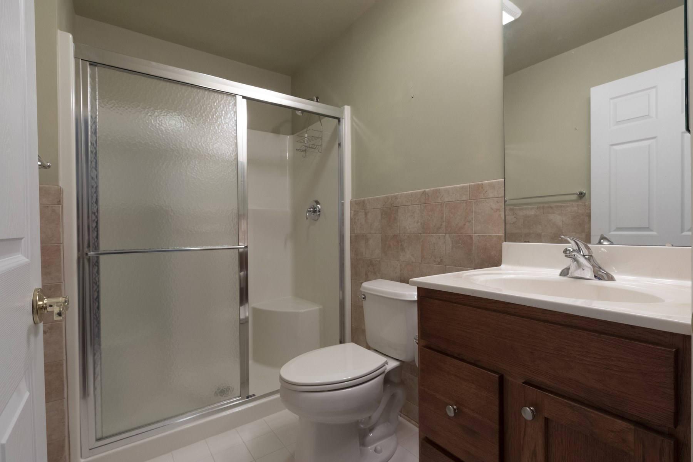

# HDR Hybrid Fusion

Adaptive deep-learning-based HDR image fusion for real-estate interior photography.

## Overview

Combines underexposed, normal, and overexposed images using a CNN-based adaptive fusion model, followed by shadow and detail recovery.

## Sample Results

### Input Exposures

| Underexposed | Normal | Overexposed |
|---|---|---|
|  |  |  |

### Fused Output


## Architecture

- 12-channel input representation
- CNN feature extraction
- Four residual blocks
- Per-pixel exposure weighting
- Softmax-based exposure fusion
- Tiled inference
- Adaptive shadow and detail recovery

## Processing Pipeline

1. Load three exposure images.
2. Predict adaptive exposure weights.
3. Generate initial fused image.
4. Apply adaptive shadow recovery.
5. Anchor colour to normal exposure.
6. Recover detail at native resolution.

## Repository Structure

```text
HDR-Hybrid-Fusion/
├── checkpoints/
├── scripts/
├── samples/
├── reports/
├── src/
├── tests/
├── configs/
└── registered_detail_fusion/
```

## Installation

```bash
pip install -r requirements.txt
```

Install a compatible PyTorch build separately.

## Model

Selected checkpoint: `checkpoints/fusion_best.pt`

## Dataset

Datasets are excluded from this repository. Provide your own images and manifest.

## Future Work

Registered Detail Fusion will be developed independently in `registered_detail_fusion/`.

## Status

Research and development.
