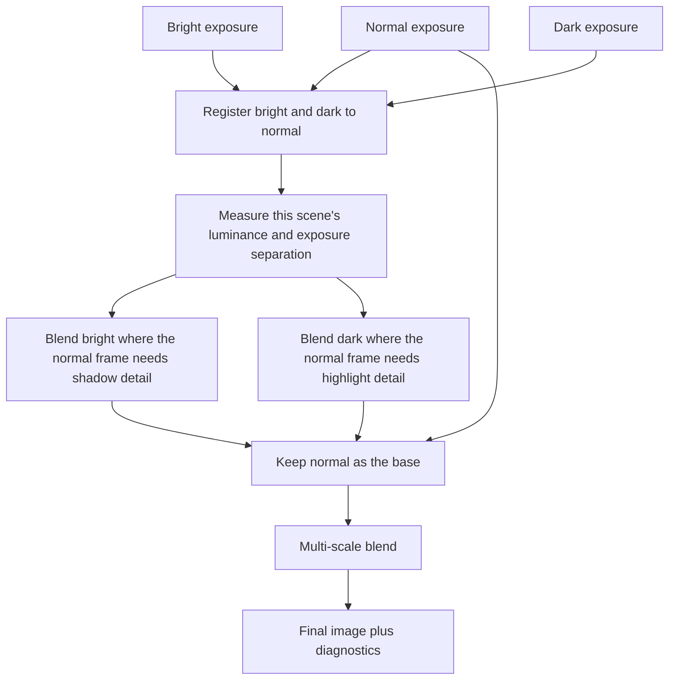
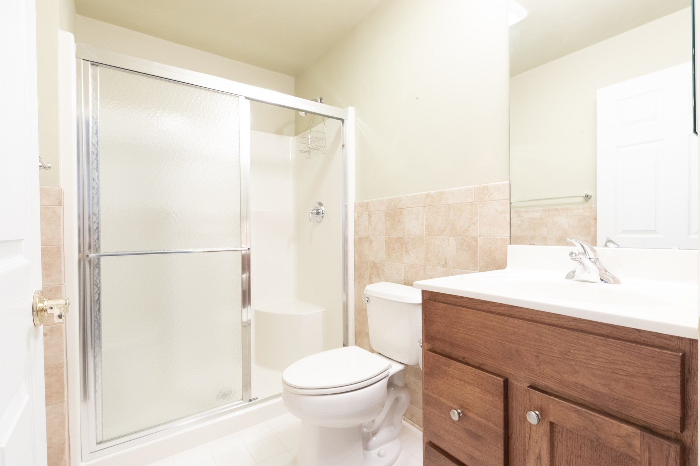
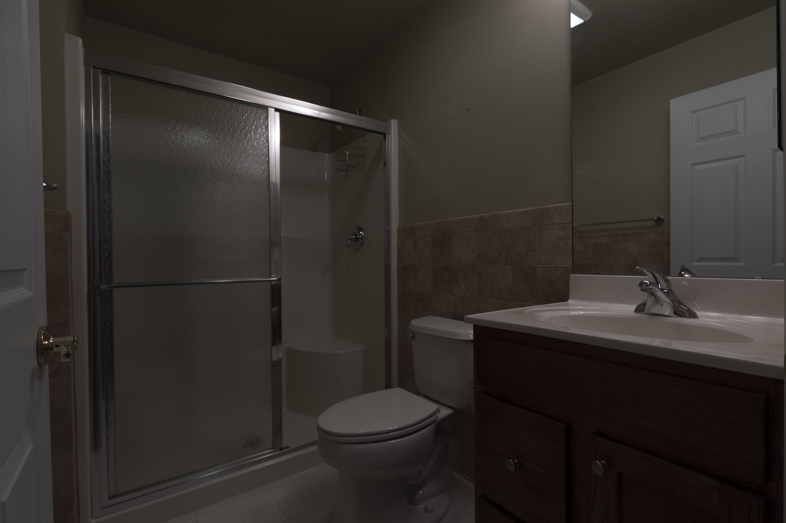
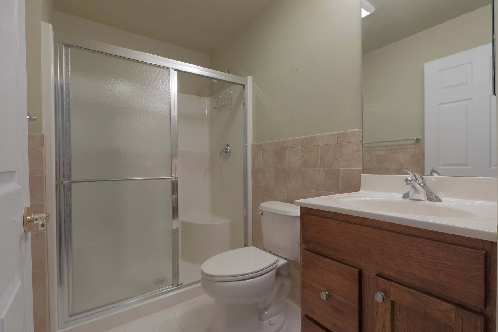

# HDR Final Git

A deterministic, adaptive fusion model for three bracketed interior photographs. It uses the normal exposure as the anchor, the bright exposure to recover usable shadow detail, and the dark exposure to recover usable highlight detail. Scene thresholds and blend strength are estimated from each input triplet; the model does not train on the sample rooms or memorize reference outputs.

## Pipeline



## Example bracket and result

The examples below show the same room at three exposures and the fused result. The alternate exposures contribute only where the normal frame needs detail and the source frame has usable signal.

| Bright (`over.jpg`) | Normal (`normal.jpg`) |
|---|---|
|  |  |

| Dark (`under.jpg`) | Fused output |
|---|---|
|  |  |

## Quick start

Python 3.10 or newer is required.

```bash
python -m pip install -e .
python scripts/fuse_three_exposures.py \
  --bright path/to/over.jpg \
  --dark path/to/under.jpg \
  --normal path/to/normal.jpg \
  --output path/to/final.jpg
```

The command prints JSON diagnostics, including registration confidence and the per-scene adaptive thresholds and contribution strengths. Inputs must be from the same scene and have matching dimensions and bit depth. The normal exposure is passed as `--normal`; the order of the options does not change their meaning.

JPEG, PNG, and TIFF inputs are supported. Supported camera RAW inputs require `python -m pip install -e ".[raw]"`. Use a `.tif` or `.tiff` output for a 16-bit TIFF master; install `tifffile` for 16-bit TIFF output. The optional `--no-align` skips registration. `--shadow-strength` and `--highlight-strength` override adaptive settings when you need manual control.

## How it works

1. Load the three exposures and use the normal frame's white balance when rendering RAW brackets.
2. Register the bright and dark frames to the normal frame. A low-confidence alignment receives no alternate-frame weight to reduce ghosting.
3. Measure luminance percentiles, available signal, and relative exposure separation for this scene.
4. Build soft shadow and highlight masks. The bright frame is eligible in darker regions; the dark frame is eligible in brighter regions; the normal frame remains the anchor.
5. Blend in linear light across multiple image scales, then save the result and diagnostics.

This is a classical, unsupervised image-processing pipeline, not a trained neural network. It cannot recover detail clipped in all three frames. Moving objects, severe misregistration, and unusual exposure brackets may still produce artifacts. See [the algorithm notes](docs/ALGORITHM.md), [input/output guide](docs/INPUTS_AND_OUTPUTS.md), and [reproducibility guide](docs/REPRODUCIBILITY.md).

## Minimal project contents

- `src/hdrfusion/three_exposure.py` — adaptive fusion algorithm and image/RAW I/O.
- `scripts/fuse_three_exposures.py` — one-triplet command-line interface.
- `pyproject.toml` — package metadata and dependencies.
- `docs/` — algorithm, input, and reproducibility notes.
- `samples/` — small example bracket and output used in this README.

Datasets, training experiments, large outputs, and local environment files are not required to run this inference path.
